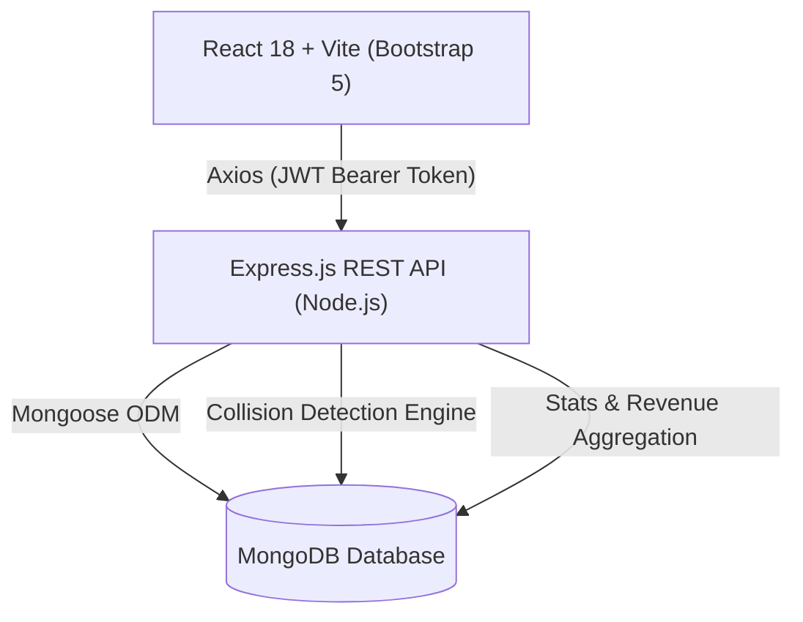

# 🏨 HotelPro — Complete Hotel Booking & Management Solution

[](https://github.com/)
[](https://react.dev/)
[](https://getbootstrap.com/)
[](https://nodejs.org/)
[](https://www.mongodb.com/)
[](https://jwt.io/)

**HotelPro** is an enterprise-grade full-stack hotel reservation and property management solution designed for modern hospitality businesses. Built specifically to fulfill the capstone requirements for **SkillWallet / SmartInternz Full Stack Development (MERN Stack)**.

---

## 🌟 Key Features

### 👤 Guest Experience
* **Dynamic Room Discovery**: Filter rooms by category (*Standard, Deluxe, Suite, Executive, Family*), budget range ($100 – $600/night), and guest capacity.
* **Real-Time Collision Avoidance**: Calendar reservation engine that prevents double-booking rooms for overlapping dates.
* **Transparent Breakdown**: Automatic calculation of night stay durations, tax and service fees (10%), and total cost.
* **Personalized Dashboard**: View confirmed and past reservations, with one-click stay cancellation and automated refund handling.
* **Instant Demo Logins**: 1-click evaluation buttons on the sign-in page to test as a Guest or an Administrator without typing credentials.

### 🛡️ Admin & Property Management Operations
* **Executive Telemetry**: Live metrics for Total Revenue ($), Active Bookings, Occupancy Rate (%), and Inventory breakdown.
* **Inventory Control**: Add, modify, or retire rooms with rich details (amenities, high-res photography, size in sq.ft, bed configuration, room numbers).
* **Reservation Lifecycle**: Real-time transition of guest bookings across states: `Confirmed` &rarr; `Checked-In` &rarr; `Checked-Out` &rarr; `Cancelled`.
* **RBAC & Security**: Strict role-based route protection with JSON Web Tokens (JWT) and Bcrypt salted password hashing.

---

## 📐 System Architecture



---

## 🚀 Quick Start Guide

### Prerequisites
* **Node.js** (v18 or higher)
* **npm** (v8 or higher)
* **MongoDB** (Local instance or free [MongoDB Atlas Cluster](https://www.mongodb.com/atlas))

### 1. Clone & Install Dependencies
```bash
git clone <your-repo-link>
cd hotelpro-mern

# Install server dependencies
cd server
npm install

# Install client dependencies
cd ../client
npm install
```

### 2. Environment Configuration
Create a `.env` file in `server/.env`:
```env
PORT=5000
MONGO_URI=mongodb+srv://<username>:<password>@cluster.mongodb.net/hotelpro?retryWrites=true&w=majority
JWT_SECRET=hotelpro_super_secure_jwt_secret_key_2026_xyz
NODE_ENV=development
```

### 3. Seed Sample Data (Curated Luxury Rooms & Users)
```bash
cd server
npm run seed
```
This populates:
* **8 Curated Luxury & Standard Suites** with realistic Unsplash photography and amenities.
* **Admin Account**: `admin@hotelpro.com` / `admin123`
* **Guest Account**: `guest@hotelpro.com` / `guest123`
* **Sample Booking** for immediate live metrics on the admin console.

### 4. Run the Application
In terminal 1 (Backend):
```bash
cd server
npm run dev
# Server runs on http://localhost:5000
```

In terminal 2 (Frontend):
```bash
cd client
npm run dev
# Frontend runs on http://localhost:3000
```

---

## 🔑 Mentor Evaluation Credentials

| Role | Email | Password | Access Level |
|---|---|---|---|
| **Administrator** | `admin@hotelpro.com` | `admin123` | Full Admin Console, Inventory Management, All Bookings |
| **Demo Guest** | `guest@hotelpro.com` | `guest123` | Room Booking, Profile, My Reservations, Cancel Stay |

*Tip: On the Sign-In page (`/login`), click the **"⚡ 1-Click Mentor Evaluation Logins"** buttons for immediate sign-in!*

---

## 📡 REST API Specifications

### Authentication (`/api/auth`)
* `POST /api/auth/register` — Register a new guest user
* `POST /api/auth/login` — Sign in and receive JWT token
* `GET /api/auth/me` — Retrieve authenticated user profile (Protected)
* `GET /api/auth/users` — Get all users (Admin only)

### Rooms (`/api/rooms`)
* `GET /api/rooms` — Search & filter rooms (query: `type`, `minPrice`, `maxPrice`, `guests`, `checkIn`, `checkOut`, `search`)
* `GET /api/rooms/:id` — Get room details by ID
* `POST /api/rooms` — Add new room (Admin only)
* `PUT /api/rooms/:id` — Update room specifications (Admin only)
* `DELETE /api/rooms/:id` — Delete room from inventory (Admin only)

### Bookings (`/api/bookings`)
* `POST /api/bookings` — Create a new reservation with date overlap check (Protected)
* `GET /api/bookings/my-bookings` — Get current user's reservations (Protected)
* `GET /api/bookings` — Get all hotel bookings (Admin only)
* `GET /api/bookings/:id` — Get single booking details (Protected)
* `PUT /api/bookings/:id/status` — Update reservation status (Admin only)
* `PUT /api/bookings/:id/cancel` — Cancel reservation & trigger refund (Protected)

### Analytics (`/api/stats`)
* `GET /api/stats/dashboard` — Get KPI metrics (Total revenue, active reservations, occupancy rate %, recent bookings) (Admin only)

---

## ☁️ Deployment Instructions

### Deploy Backend on Render
1. Push repository to GitHub.
2. Create a **Web Service** on [Render](https://render.com).
3. Set **Root Directory** to `server`.
4. Set **Build Command** to `npm install`.
5. Set **Start Command** to `node server.js`.
6. Add environment variables: `MONGO_URI`, `JWT_SECRET`, `NODE_ENV=production`.

### Deploy Frontend on Vercel
1. Import repository on [Vercel](https://vercel.com).
2. Set **Root Directory** to `client`.
3. Set **Build Command** to `npm run build` and **Output Directory** to `dist`.
4. Add environment variable: `VITE_API_URL=https://<your-render-backend-url>/api`.

---

## 📂 Project Structure

```
hotelpro-mern/
├── client/                     # React + Vite Frontend
│   ├── public/                 # Static assets & favicon
│   ├── src/
│   │   ├── components/         # Navbar, Footer, RoomCard, ProtectedRoute
│   │   ├── context/            # AuthContext (JWT state management)
│   │   ├── pages/              # Home, Rooms, RoomDetails, Login, Register, MyBookings
│   │   │   └── admin/          # AdminDashboard, AdminRooms, AdminBookings
│   │   ├── services/           # Axios API instance with interceptors
│   │   ├── App.jsx             # React Router routing configuration
│   │   ├── index.css           # Custom styling overrides
│   │   └── main.jsx            # Entry point with Bootstrap bundle
│   ├── index.html
│   ├── package.json
│   └── vite.config.js
├── server/                     # Node.js + Express Backend
│   ├── config/                 # MongoDB Mongoose connection
│   ├── controllers/            # Auth, Rooms, Bookings, Stats controllers
│   ├── middleware/             # Auth JWT guard, Admin guard, Error handler
│   ├── models/                 # User, Room, Booking Mongoose Schemas
│   ├── routes/                 # Express API routes
│   ├── seeder.js               # Database seeding script with luxury rooms
│   ├── server.js               # Server entry point
│   ├── package.json
│   └── .env.example
├── .gitignore
├── package.json
└── README.md
```

---

## 🏆 SkillWallet Epics Completion Matrix

- [x] **Epic 1**: Project Setup & Environment Configuration
- [x] **Epic 2**: Database Development & Schema Modeling
- [x] **Epic 3**: Backend REST API & JWT Security Engine
- [x] **Epic 4**: Frontend Development (React + Bootstrap 5)
- [x] **Epic 5**: Property Operations & Admin Management Workspace
- [x] **Epic 6**: Testing, Deployment Guide & Mentor Documentation
